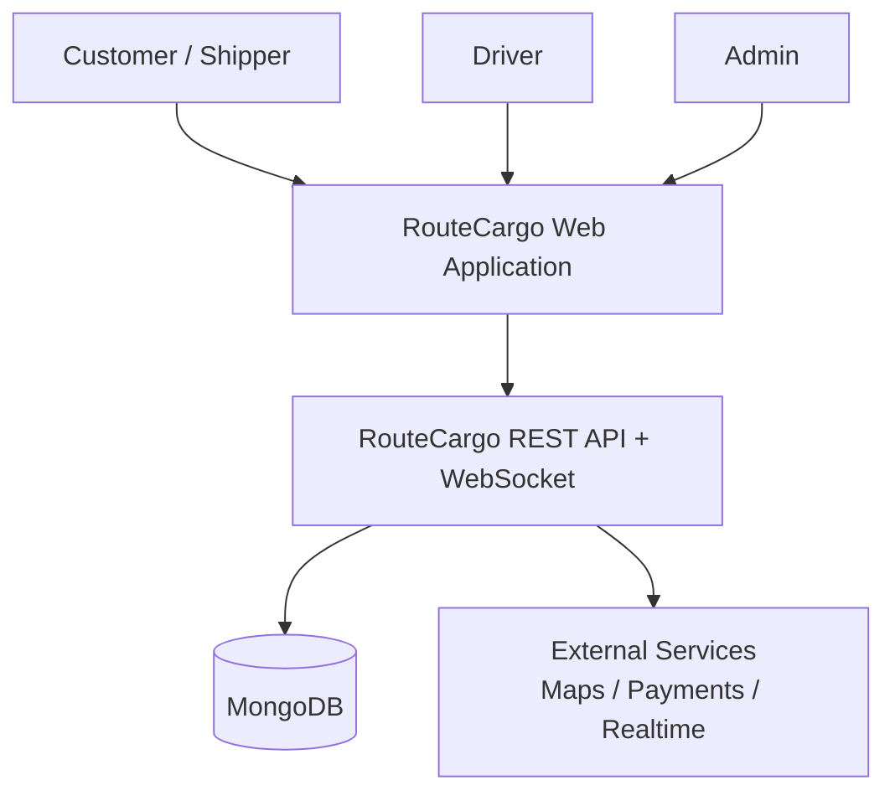

# RouteCargo — System Design

**Status:** Draft for review
**Version:** 1.0
**Owner:** DevByShree — RouteCargo

---

## 1. Purpose

Define the target system architecture for RouteCargo: how frontend, backend, data, auth, payments, tracking, and infrastructure fit together.

## 2. Architectural Style

- Frontend: React SPA (component-driven, layout routes).
- Backend: REST API + planned WebSocket realtime.
- Data: MongoDB via Mongoose (verified); PostgreSQL mentioned in docs (proposed/uncertain).
- Patterns: MVC (routes/controllers/services/models), JWT auth, role-based access.

## 3. System Context (C4 Level 1)



## 4. High-Level Architecture

### 4.1 Components

- **Client:** React SPA (`frontend/`), Vite build, Tailwind, React Router.
- **API Server:** Express (`backend/server.js` + planned `src/{routes,controllers,services,models,middleware}`).
- **Data:** MongoDB via Mongoose.
- **Auth:** JWT (planned).
- **Realtime:** WebSocket/Socket.IO (planned).
- **Payments:** Gateway + escrow (planned).
- **Maps:** Third-party (planned).

### 4.2 Request Flow

```
Browser (React) → HTTP/REST → Express middleware → controller → service → model → MongoDB
Realtime updates → WebSocket/Socket.IO → React client
```

## 5. Frontend Design

- Routing: React Router v7 (`App.jsx`).
- Layout: `CustomerLayout` (Sidebar + DashboardNavbar + Outlet).
- State: local + planned Context/API layer; auth token in localStorage (key: `token`).
- Styling: Tailwind v4.

## 6. Backend Design

- Layered: routes → controllers → services → models.
- Middleware: CORS, JSON body, auth, error handling.
- Config: env vars (`PORT`, `MONGO_URI`).

## 7. Data Design

**Entities (planned):** User, Driver, Vehicle, Trip, Shipment, Booking, Payment, Tracking.

**Relationships:** User 1—N Driver; Driver 1—N Trip; Trip 1—N Shipment/Booking; Shipment 1—N Tracking; Booking 1—N Payment.

## 8. API Design

Proposed endpoints (auth-gated): `/api/auth/*`, `/api/drivers/*`, `/api/trips/*`, `/api/shipments/*`, `/api/bookings/*`, `/api/payments/*`, `/api/tracking/*`.

## 9. Security Design

- JWT access/refresh, RBAC, input validation, rate limiting, helmet, CORS allowlist, encrypted secrets, audit logs.

## 10. Deployment Architecture

- Frontend static hosting; backend container; managed DB; env-based config; CI/CD.

## 11. Cross-cutting Concerns

- Logging, monitoring, error handling, health checks.

## 12. Open Questions

- Final DB engine, auth provider, payment gateway, realtime stack.

---

*Related documents: `docs/architecture.md`, `docs/PRD.md`.*
