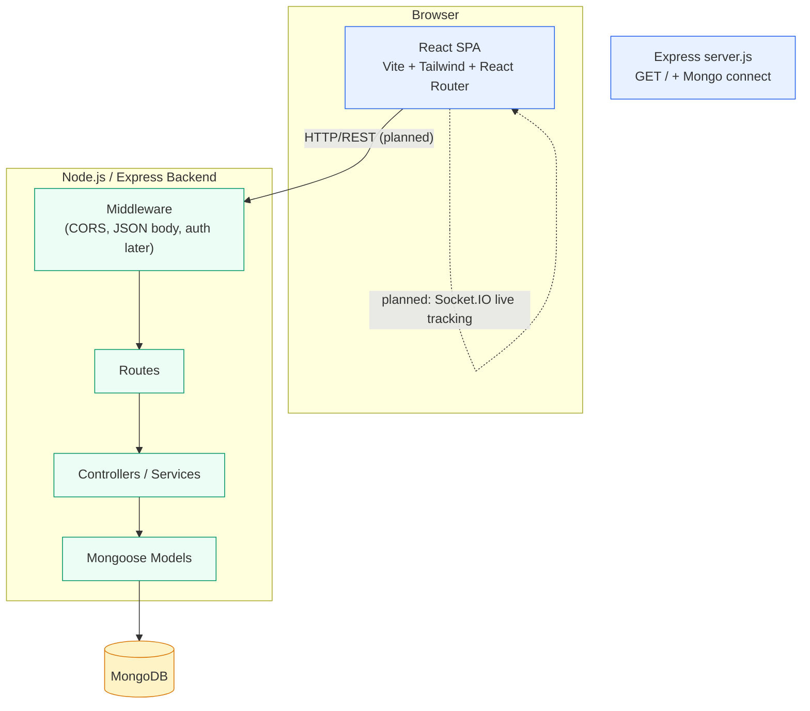

# RouteCargo — Architecture & Context Documentation

> **Audit type:** Read-only architectural audit prepared for future AI coding sessions.
> **Project:** RouteCargo (formerly referenced as "RouteShare") — a transport & logistics marketplace connecting shippers who need parcel transport with drivers who are already traveling (shared truck capacity).

---

## 1. Project Purpose and Scope

RouteCargo connects users who need goods transported with drivers and transportation providers who can fulfil those shipments.

The platform may include the following capabilities, depending on what is already implemented in the repository:

- User registration, login, authentication, and role-based access.
- Driver registration and profile management.
- Driver verification and KYC documentation.
- Truck and vehicle management.
- Shipment creation with pickup and delivery locations.
- Goods information, truck requirements, and offered transportation prices.
- Driver requests and quotations for shipments.
- Shipment owners reviewing, accepting, or rejecting driver offers.
- Booking confirmation and shipment assignment.
- Shipment status updates and delivery tracking.
- Payment records and transaction status.
- User dashboards, driver dashboards, and administrative functionality.

> **Status:** The above are treated as **product requirements**. The current repository state is evaluated against them in Section 10.

---

## 2. Verified Technology Stack

### 2.1 Frontend (verified)

| Concern | Technology | Evidence |
|---|---|---|
| UI library | React 19 (`react@^19.2.8`, `react-dom@^19.2.8`) | `frontend/package.json` |
| Routing | React Router DOM v7 | `frontend/src/App.jsx`, layouts |
| Styling | Tailwind CSS v4 via `@tailwindcss/vite` | `frontend/vite.config.js`, `frontend/src/index.css` (`@import "tailwindcss";`) |
| Build tool | Vite 8 + `@vitejs/plugin-react` | `frontend/vite.config.js`, `frontend/package.json` |
| Icons | `lucide-react`, `react-icons` (`fa`, `fi` subpaths) | Layout/pages imports |
| Language | JavaScript JSX (not TypeScript) | Source files; `@types/*` are dev-only |
| Linting | ESLint 10 flat config (`@eslint/js`, `eslint-plugin-react-hooks`, `eslint-plugin-react-refresh`, `globals`) | `frontend/eslint.config.js` |
| Dev types | `@types/react`, `@types/react-dom` (dev) | `frontend/package.json` |
| State management | **None global** — local `useState` only; no Context/Redux/Zustand | Source audit |
| Async/data layer | **None** — no fetch/axios; no API service module | Source audit, `frontend/src/API/` is empty |

### 2.2 Backend (verified)

| Concern | Technology | Evidence |
|---|---|---|
| Runtime | Node.js + Express 5 | `backend/server.js`, `backend/package.json` |
| ODM | Mongoose 9 (MongoDB) | `backend/package.json`, `backend/server.js` |
| Env config | `dotenv` | `backend/server.js` |
| CORS | `cors` installed, **not yet applied** | `backend/package.json`, `server.js` has no `cors` usage |
| Dev runner | `nodemon` | `backend/package.json` scripts |
| Scaffolding | `src/{config,controllers,middleware,models,routes}` — all currently **empty** | Directory audit |

### 2.3 Database

- **MongoDB via Mongoose ODM.**
- Connection via `backend/.env` → `MONGO_URI`; server port via `PORT` (default `5000`).
- **No Mongoose models have been defined yet.**

### 2.4 External / Planned Services

- Maps / routing / ETA: planned (per `frontend/README.md`).
- Payments gateway / escrow: planned.
- Real-time tracking (WebSocket/Socket.IO): planned.
- Auth: planned backend implementation (JWT); frontend reads a `token` key from `localStorage` but nothing writes it yet.

---

## 3. Repository Structure and Important File Locations

```
RouteCargo/
├── Agent.md                        # AI operating rules (untracked) — read before any AI session
├── requirement.txt                  # Root-level npm package list (frontend + backend)
├── .gitignore
├── backend/
│   ├── .env                         # PORT, MONGO_URI (key names only; values must not be committed)
│   ├── package.json                 # express, mongoose, cors, dotenv (+dev: nodemon)
│   ├── package-lock.json
│   ├── server.js                    # Express app: GET /, Mongo connect, listen
│   └── src/
│       ├── config/                  # EMPTY
│       ├── controllers/             # EMPTY
│       ├── middleware/              # EMPTY
│       ├── models/                  # EMPTY
│       └── routes/                  # EMPTY
├── frontend/
│   ├── README.md                    # Product spec ("RouteShare") — concept stage
│   ├── index.html
│   ├── vite.config.js
│   ├── eslint.config.js
│   ├── package.json / package-lock.json
│   └── src/
│       ├── main.jsx                 # React root
│       ├── App.jsx                  # Router + routes
│       ├── index.css                # Tailwind import
│       ├── API/                     # EMPTY (planned API service layer)
│       ├── assets/                  # images
│       ├── Layout/                  # CustomerLayout, DashboardNavbar, Navbar, Sidebar
│       └── Pages/
│           ├── LandingPage.jsx
│           ├── components/First.jsx
│           ├── Authentication/{Signin,Signup}.jsx
│           ├── Customer/{Dashboard,Find_Trucks,My_Booking,Parcel,Payment,Profile,Saved_Address,Shipment,Tracking}/...
│           └── Driver/              # directories only — no files implemented yet
└── docs/                            # (to be created) this architecture document
```

---

## 4. Current System Architecture

### 4.1 Architecture Overview (verified current state)

- **Frontend:** React SPA (`BrowserRouter`) served by Vite. Customer routes are nested under a layout route (`CustomerLayout`) that renders `Sidebar` + `DashboardNavbar` + child route (`Outlet`).
- **Backend:** Express server. Currently exposes only `GET /` (health check) and attempts a Mongoose connection to `MONGO_URI`.
- **Database:** MongoDB via Mongoose — connection attempted, no persistence layer implemented yet.
- **Integration:** **Not yet implemented.** The frontend contains no HTTP client calls to the backend, and the backend registers no frontend-facing REST routes. The architecture is therefore: *two isolated applications awaiting integration*.

### 4.2 Mermaid Architecture Diagram



### 4.3 Verified Request Lifecycle (backend, as currently implemented)

```
HTTP request → Express app (express.json()) → GET / handler → MongoDB via Mongoose
```

No further middleware/route/controller layers exist yet.

---

## 5. Frontend Architecture

### 5.1 Routing (verified from `frontend/src/App.jsx`)

Public:

- `/` → `LandingPage`
- `/signup` → `Signup`
- `/signin` → `Signin`

Customer (nested under `CustomerLayout`):

- `/dashboard`
- `/Find`
- `/Booking`
- `/track`
- `/address`
- `/payment`
- `/profile`
- `/shipment`
- `/parcel`

### 5.2 Layout & Navigation

- `CustomerLayout`: sidebar + top dashboard navbar + `<Outlet />`.
- `Sidebar`: collapsible (icons-only below `md`), mobile drawer; menu items: Dashboard, Create Shipment, Parcel Details, Find Trucks, My Bookings, Tracking, Payments, Saved Addresses, Profile.
- `DashboardNavbar`: top bar with branding, search (commented out), notifications, profile; currently shows **hardcoded user** ("Shree Joshi", role "Customer").
- `Navbar` (marketing): `navLinks` for Shippers / Drivers / How It Works / Pricing / About / Contact; auth-aware via `localStorage.getItem("token")`.

### 5.3 State & Data Handling (verified)

- Local component state via `useState`/`useEffect`/`useMemo`/`useRef`.
- **No global state library, no Context API.**
- Auth flag: read from `localStorage.token` (in `Navbar`); **no login/signup submit handler writes the token** and no API call persists it.
- No fetch/axios/API module → **frontend-backend integration not started**.

### 5.4 Implemented Pages (verified by file + size)

| Page | Path | Status |
|---|---|---|
| Landing | `/` | Implemented (marketing + FAQ) |
| Sign In | `/signin` | Implemented (static form) |
| Sign Up | `/signup` | Implemented (static form) |
| Dashboard | `/dashboard` | Implemented (local state + navigation) |
| Find Trucks | `/Find` | Implemented (filters in local state) |
| My Bookings | `/Booking` | Implemented (tabs) |
| Tracking | `/track` | Implemented (map mode toggle) |
| Payments | `/payment` | Implemented (tabs/filters/pagination over local state) |
| Saved Addresses | `/address` | Implemented (form validation + address list in local state) |
| Profile | `/profile` | Implemented (local editing state) |
| Shipment | `/shipment` | Implemented (form state; pickup/delivery defaults; commented date/time) |
| Parcel | `/parcel` | Implemented (shipment creation wizard incl. image capture via refs/camera) |
| `shipmengt.jsx` | — | **0 bytes** (typo filename, empty) |

### 5.5 Not Implemented (directories only)

- `frontend/src/Pages/Driver/**` — only empty subdirectories (`Active_Trip`, `Dashboard`, `Earning`, `My_trip`, `Profile`, `Raise_Request`, `Reviews`) → **no driver UI code**.
- Admin pages: none.
- `frontend/src/API/`: empty → planned API service layer.

---

## 6. Backend Architecture

### 6.1 Current Server (`backend/server.js`)

```js
const express = require("express");
const mongoose = require("mongoose");
require("dotenv").config();

const app = express();
app.use(express.json());
app.get("/", (req, res) => res.send("RouteCargo Backend is running!"));
const PORT = process.env.PORT || 5000;
// mongoose.connect(process.env.MONGO_URI) inside async startServer with try/catch
app.listen(PORT, ...);
```

### 6.2 Verified Backend Inventory

- **Endpoints implemented:** `GET /` only.
- **Middleware:** none registered (no CORS, no auth, no error handler).
- **Controllers/Services/Models/Routes:** folders exist but **empty** — no business logic yet.
- **Dependencies:** `cors`, `dotenv`, `express`, `mongoose`; dev: `nodemon`.
- **Scripts:** `dev` → `nodemon server.js`; `test` → placeholder error.

### 6.3 Backend Integration Readiness

- `cors` is installed but unused → must be applied before browser-based frontend calls.
- No global API prefix (e.g., `/api`) established yet.

---

## 7. Database Architecture

- **DBMS:** MongoDB (Mongoose ODM).
- **Connection:** `MONGO_URI` from `backend/.env`.
- **Models:** none defined yet (folder empty).
- **Entities anticipated** (per product docs, not yet coded): User, Driver, Vehicle, Trip, Shipment, Booking, Payment, Tracking.

---

## 8. API Architecture

- **Verified APIs:** `GET /` — purpose: health check; auth: none; response: plain string.
- **Planned:** full REST API per product spec (auth, shipments, bookings, payments, tracking).

---

## 9. Business Workflows

Workflows are documented at product level but **not yet implemented** in code. Implemented frontend pages cover only isolated UI slices (forms, lists, tabs) with local state; the end-to-end flows (registration→login→KYC→trip→booking→payment→tracking) are pending backend + integration work.

---

## 10. Implementation Status

| Area | Status |
|---|---|
| Landing page / marketing | Implemented (verified) |
| Sign In / Sign Up UI | Implemented (static; no submit logic) |
| Customer dashboard / lists / forms | Implemented (local state; no backend) |
| Driver portal | **Not implemented** (empty folders) |
| Admin portal | **Not implemented** |
| Backend server + health check | Implemented (partial) |
| Backend auth / models / routes / controllers | **Not implemented** |
| Frontend ↔ Backend integration | **Not implemented** |
| Database models / migrations | **Not implemented** |
| Payments / tracking / realtime | Planned |

---

## 11. Security and Data Integrity

- `.env` exists in `backend/` with keys `PORT` and `MONGO_URI`; `.gitignore` includes `.env` (good).
- No secrets are recorded in this document.
- Current backend has no auth middleware, no input validation, no rate limiting, no helmet/CORS config, no error handler beyond basic try/catch.
- Frontend auth is client-side only (localStorage token read) — no secure storage, no session handling.

---

## 12. Development and Testing Instructions (verified commands)

- Backend: `cd backend && npm run dev` (nodemon) / `npm start`? *(note: only `dev` and placeholder `test` scripts exist)*
- Frontend: `npm run dev`, `npm run build`, `npm run lint`, `npm run preview`

---

## 13. Known Issues and Unresolved Questions

- Backend was recently stripped of implementation files; server reduced to health check + DB connect.
- `frontend/index.html` title is generic ("frontend").
- `frontend/src/Pages/Customer/Shipment/shipmengt.jsx` is empty (typo).
- Driver pages directories exist but contain no files/routes.
- No global error handling, auth guard, or API base URL configuration in frontend.
- `cors` installed but unused.

---

## 14. Proposed Operating Rules for Future AI Sessions (proposed `AGENTS.md` content)

*(To be formalized into `AGENTS.md` after owner approval — see final response)*

1. Read `AGENTS.md` and relevant docs before starting work.
2. Inspect existing implementations before suggesting new code.
3. Reuse existing components/models/APIs/utilities.
4. Preserve architecture and conventions.
5. Never assume a feature/API/field exists without verification.
6. Explain proposed change; list affected files.
7. Request explicit approval before editing any file.
8. Modify only approved scope.
9. No unrelated refactoring or automatic fixes.
10. Re-ask if scope expands.
11. Never expose secrets or run destructive DB ops without permission.
12. Report changes and actual test results after approved implementation.
13. Explain/review without modifying.
14. State uncertainty rather than inventing answers.

---

## 15. Open Questions Requiring Owner Input

1. Is the product name "RouteCargo" or "RouteShare"?
2. Should the backend API use a versioned prefix (e.g., `/api/v1`)?
3. Which auth mechanism (JWT, sessions) is planned before implementation?
4. Which database do they actually run locally (`MONGO_URI` value)?
5. Confirmation needed on whether to create `docs/architecture.md` under the requested name and whether an `AGENTS.md` should follow.

---

*End of audit document. Verified facts are separated from recommendations; unknowns are marked.*
